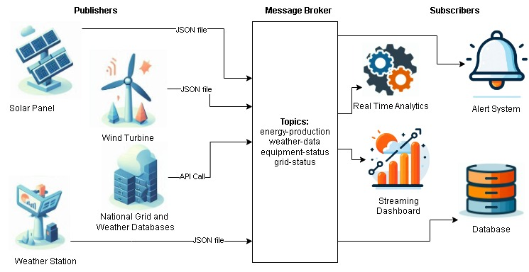

# Streaming Data Analytics
Programming projects for a streaming data course at Colorado Technical University (CS367) taken in the fall of 2024. Each project focused on a major tenet of streaming data. I did 5 projects over the 5 week class.

## Highlighted Project: Design a Pub/Sub Architecture for a Renewable Energy Company

### Background
The purpose of this project is to design the architecture for a publish/subscribe streaming data system. A fictitious renewable energy company is the chosen field, where the company produces solar and wind power and needs to know electricity production and demand throughout the grid. 
### Architecture

The above diagram shows the architecture of the pub/sub system. 

**Data Source/Publishers:** The data sources (publishers) are the company's solar panels, wind turbines, and weather stations (sent via JSON files), as well as electric grid and weather databases (sent via API calls). 

**Topics:** Their data is sent to several message topics shown in the message broker (Apache Kafka). The topic threads are about energy production, weather data and forecasting, the state of proprietary equipment to monitor issues, and grid-wide energy demand and supply.

**Subscribers:** Several systems subscribe to the message topics: real time analytics and streaming dashboards (Apache Spark), an alert system for possible equipment issues, and a database (Amazon S3) to store aggregated results.

| Topic | Publishers | Subscribers
| ---| ---| ---| 
|energy-production | solar panels, wind turbines, national grid database | real time analytics, streaming dashboard, database |
| weather-data | weather stations, weather database | real time analytics, streaming dashboard, alert system, database |
|equipment-status | solar panels, wind turbines, weather stations | real time analytics, streaming dashboard, alert system, database |
| grid-status | grid database | real time analytics, streaming dashboard, database |

### Status
Project [architecture, design and pseudocode](Unit2/IP2-pub-sub-energy.pdf) to create the system are complete. Implementing the project [in code](Unit2/IP2_pub_nub.py) has started, but is not yet finished. 

### Next Steps
Complete the pub/sub architecture in code, then flesh out the inputs and outputs of the project to create real data input streams (API calls to data sources) and real data output streams (analysis and dashboards visualizing results). 

## Complete List of Projects
The following provides a quick summary of the project for each unit, which correspond to the directory files in this repository. 

### Unit1: Loading Streaming Data from the Titanic Dataset
Set up an environment and pipeline for streaming data using the Titanic dataset as a proof of concept. The Python library `streamz` is used to create a data stream, and `pandas` performs some basic data structuring and cleaning.

### Unit2: [Design a Pub/Sub Architecture for a Renewable Energy Company](#highlighted-project-design-a-pubsub-architecture-for-a-renewable-energy-company)
Described in more detail in the featured project section. The design, architecture, pseudocode and partial implementation for renewable energy, electric grid, and weather streaming data. The purpose is to pull relevant data into defined topics from which different software systems use those data streams.

### Unit3: Predictive Machine Learning Algorithms on Tweet Streams
This project was to derive insights from tweets by applying a machine learning algorithm on the data stream. The program subscribes to the PubNub twitter channel as a data stream source. The data is formatted as a dictionary of key-value pairs and stored in a rolling window of the 100 most recent tweets. Exploratory analysis and applying a machine learning algorithm is not complete. Interesting results about tweet location, number of followers, and frequency of tweets could be derived from a K-means clustering algorithm.

### Unit4: Tracking Changes to Wikipedia Articles
To help track and understand incremental changes within a data lake, this project creates a query algorithm to track edits made to Wikipedia articles. It ingests streaming data via a PubNub channel and the `streamz` library and applies a basic query algorithm to it to keep a running tally of the number of Wikipedia changes made since the program started, the past minute, the past hour, and the past day. Both the ingest stream and the analysis stream run simultaneously using the Python `threading` library. The next step is to visualize these results and expand the query algorithm to filter by user, topic, location or article.

### Unit5: Full Streaming Data Pipeline to Predict Stock Prices
This final project pulls in every part of a streaming data analysis pipeline: data ingestion, cleaning, storage, exploratory analysis, and predictive analytics for simulated stock market orders. The streaming stock market orders are from PubNub and ingested with `streamz`, which sends the data through several channels. One channel to  explore the data with summary statistics in `pandas`, one to train a linear regression model, and the last to predict future stock prices with the trained model using `scikit-learn`. 